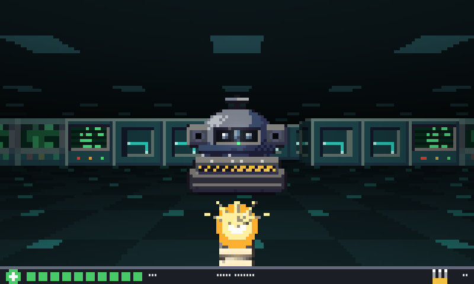
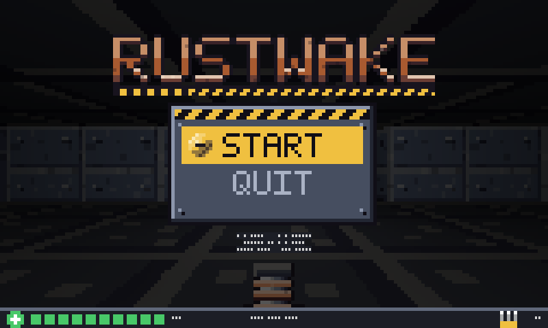
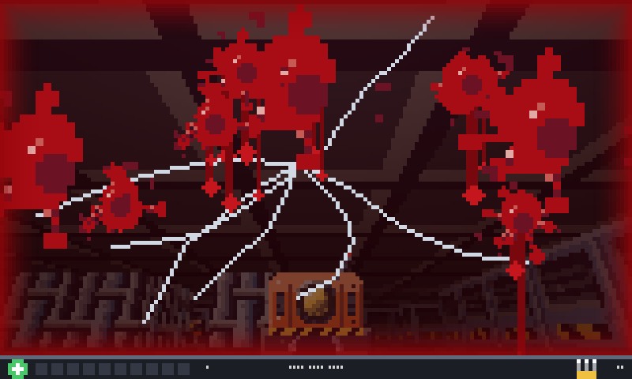

# RUSTWAKE

An original first-person shooter for the terminal, written in Go. Clear the rogue machines out of a dark plant, one map at a time. It is drawn with [glonk](https://github.com/kyrokohan/glonk), a terminal rendering engine for Go.



## Play

```
go install github.com/kyrokohan/rustwake@latest
rustwake
```

Start on a later level with `rustwake -level 7`. There are 12.

If your shell says `rustwake: command not found`, Go's install folder is not on your PATH. Add it (`go env GOPATH` shows where it is, usually `~/go`):

```
export PATH="$PATH:$(go env GOPATH)/bin"
```

You need:

- Go 1.27.2 or newer, to install it
- A terminal with true color (24-bit). 80 by 24 works; 160 columns or wider shows the large title
- For walking and turning at the same time, a terminal that reports key releases: Ghostty, kitty or WezTerm. In others, only one key is held at a time

| Key | Does |
|---|---|
| W / S | walk forward / back |
| A / D | strafe |
| Left / Right, or Q / E | turn |
| Space | fire |
| Esc | pause |

Menus: up and down, Enter.

## The game

Find the exit (a green lamp on a steel post) on each map. Health packs and ammo lie about. A shot does one point of damage and spends one round, so aim.

- **Crawler**: walks at you and bites
- **Sentry**: stands back and fires bolts
- **Drone**: fast, floats, falls to one hit
- **Hauler**: slow, takes eight hits, hits hard
- **Overseer**: the boss of the last map, takes forty hits, fires three bolts at once

The 12 maps come in three zones of four, each with its own walls, floors and ceilings:

1. Pump Hall, Filter Beds, Pipe Gallery, Sluice Gate
2. Slag Run, Casting Floor, Ore Lift, Furnace Row
3. Cable Trench, Relay Hall, Cold Core, Control

If your health runs out, the screen cracks and runs red, then you can retry the map or quit.





## How it is made

- **Render:** glonk draws the world as shaded 3D meshes on a half-block pixel canvas. Machines, pickups and props are pictures drawn over it, hidden by walls through glonk's depth buffer.
- **Art:** every picture is drawn by code in `tools/artgen`, with no outside assets. `go run ./tools/artgen` draws them again, byte for byte the same. Add `-preview <folder>` to see them enlarged.
- **Maps:** plain text in `levels/`, checked by the tests. `#`, `%` and `&` are walls (one picture each per zone), `.` is floor, `@` is the start and `E` the exit. `c s d H B` are machines, `h` and `a` are health and ammo, and `o x l` are barrels, crates and lamps.

## Develop

```
go test ./...
```

To look at frames without a terminal, write them as PNG files:

```
RUSTWAKE_SNAP=/some/folder go test -run TestSnapshot .
```

## Known limits

- Machines walk straight at you, so one can get stuck behind a corner
- No sound
- glonk is pinned to a commit on its `main`, not a release

## License

MIT, for the code and the art. See [LICENSE](LICENSE).
